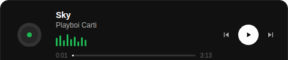

  

 

 

  
Estudante de Análise e Desenvolvimento de Sistemas na <b>UNIFIA</b>.

  
Construo experiências web interativas, do layout ao deploy.

  
🔎 <b>Buscando estágio / vaga júnior em desenvolvimento web.</b>

 

---

## 🛠️ Stack

---

## 🚀 Projetos

| Projeto | O que é | Tecnologias |
|---|---|---|
| 🌌 [**Sistema Solar**](https://github.com/PHKaiba/system_solar) | Visualização 3D interativa do sistema solar, com planetas, órbitas e animação em tempo real. | Three.js, JavaScript, HTML |
| 🏆 [**Palmeiras Site**](https://github.com/PHKaiba/Palmeiras-site) | Conceito de site-tributo à história do Palmeiras, com estética sofisticada e foco na emoção da arquibancada. | HTML, CSS, JavaScript |

---

  

 

---

## 📫 Vamos conversar

&nbsp;

&nbsp;

 

  Pedro Henrique &nbsp;·&nbsp; São Paulo, BR

